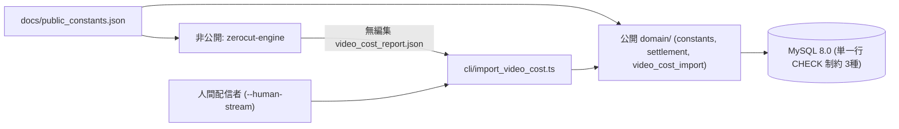

# アーキテクチャ設計書: ZeroCut Stream（公開還元・抽選プロトコル）

本ドキュメントでは、公開リポジトリ（`zerocut-stream`）の依存性注入（DI）アーキテクチャ、非公開エンジンリポジトリとの疎結合 JSON 境界、単一行データベース制約、および複数ゲーム公開再生数按分・等確率抽選の横断整合性仕様を定義します。

---

## 1. リポジトリ分割と DI・層分離原則

1. **公開プロトコル（`zerocut-stream`: GNU AGPLv3）と制作手段の分離**:
   - 本リポジトリは収支台帳・複数ゲーム按分・乱数抽選・Webポータルのみを担います。人間の生身配信者が運用する場合は本リポジトリ単独で完結し、AI動画生成エンジン（`zerocut-engine`: 著作権留保・非公開リポジトリ）を利用する場合は標準 JSON（`docs/video_cost_report_schema.md`）を介して疎結合に連携します。
   - 公開定数（地域別時給表・固定作業分数・双方の改定履歴 `allowedHistorical*`）は `web/src/domain/public_constants.json` として `web/` 内に静的 JSON import で同梱（単体 Docker / Vercel でも動作）し、外部エンジン参照用の `docs/public_constants.json` との完全一致を単体テストで強制します。
2. **依存性の注入（DI）と内側への依存方向**:
   - ドメイン層（`domain/`）および純粋アルゴリズム層（`lib/fair_draw.ts`）は、Prisma・HTTP（`drand` / YouTube Data API）・環境変数・UIフレームワークに一切依存しません。
3. **構造化ログと `i18n`**:
   - 全ログ出力は `pino` によるキーバリュー構造化ログで行い、通知・エラー文言はすべて `i18n` カタログ（`ja` / `en`）経由で解決します。
4. **マイグレーション管理の一本化と公開後の追加限定ルール**:
   - MySQL の `CHECK` 制約を維持するため `prisma db push` の使用を禁止し、必ず `prisma migrate deploy` で適用します。
   - 初期マイグレーションの再生成は本番稼働DBが存在しない Milestone 1.5 時点限りの措置であり、公開・本番稼働後は既存マイグレーションを絶対に変更せず、前方追加マイグレーションのみを作成します。

---

## 2. 単一行 SQL `CHECK` 制約とドメイン層「行間保存則・横断検査」の役割分担

MySQL の `CHECK` 制約は単一行内で完結する条件のみを評価できるため、DB制約とドメイン層検査の責務を以下のように明確に分担します。

### 2.1 MySQL エンジンレベルの単一行 `CHECK` 制約（3種）
1. `MonthlySettlement.chk_zero_owner_profit`: `CHECK (ownerProfitJpy = 0)`
2. `MonthlySettlement.chk_labor_cost_bounds`: `CHECK (totalLaborCostJpy >= 0 AND paidLaborCostJpy >= 0 AND paidLaborCostJpy <= totalLaborCostJpy)`
3. `SettlementGameAllocation.chk_allocation_row_bounds`: `CHECK (allocatedBudgetJpy >= 0 AND unitRetailPriceJpy > 0 AND keysPurchased >= 0 AND spentJpy >= 0 AND remainderJpy >= 0 AND spentJpy + remainderJpy = allocatedBudgetJpy)`

### 2.2 ドメイン層の 5つの横断整合性検査（`web/src/domain/settlement.ts`）
行をまたぐ集計一致および履歴・外部乱数との整合は `verifySettlementInvariants` で厳密に検査します。

1. **横断検査1（繰越連続性・実費＆固定分数人件費再計算・公開再生数按分＆行間保存則）**:
   - 直前確定月が存在する場合、`current.carryOverFromPrevJpy === previous.carryOverToNextJpy`（初月 `0`）。
   - 当月全動画が公開済み（`youtubeVideoId !== null`・`contentIdStatus !== "RESTRICTED"`、かつ `isSyntheticContent === true` なら `aiDisclosureSet === true`、`false` なら `aiDisclosureSet === false`）であること。
   - 各動画の `playLaborCostJpy` / `reviewLaborCostJpy` が公開定数の履歴許容時給・履歴許容分数からの再計算値と一致し、同月同ゲームでの `playMinutes > 0` が最大1本、同一 `rawFootageSha256` での `playMinutes > 0` 重複が0件であること。また `recordingGameCostJpy > 0` は同一ゲームにつき過去月を含め生涯1回限り・領収書URL必須・`HUMAN_PLAY` 限定であること。
   - `totalInfraCostJpy`・`totalLaborCostJpy`・`paidLaborCostJpy = min(totalLaborCostJpy, max(0, carryOverFromPrev + grossAd - totalInfra))`・`netBuybackPoolJpy` が一致し、当月動画の `gameId` 集合と `SettlementGameAllocation` 集合が一致し、`viewCountSnapshot` 合計からの Hamilton 最大剰余法按分および行間合計（`SUM(allocatedBudgetJpy) === netBuybackPoolJpy`［黒字・再生数 $>0$ 時］、`SUM(spentJpy) === totalSpentOnKeysJpy`、`SUM(keysPurchased) === totalKeysPurchased`）が1円の誤差なく成立すること。
2. **横断検査2（按分レコード単位の在庫・精算枠ID・単価・買上本数・支出額一致）**:
   - 各 `SettlementGameAllocation` に紐づく `SteamKeyInventory` 全件が `settlementId`・`allocationId`・`gameId`・`unitRetailPriceJpy` と一致し、配布済み（`isDistributed = true`）キー数が `allocation.keysPurchased`、合計額が `allocation.spentJpy` と一致すること（未配布の余剰在庫キーは支出に算入されず運営者持ち出し、孤立キーや他月精算枠キーの混入は拒絶）。
3. **横断検査3（当選本数直接検査・抽選再計算 ＆ 順位順×「ゲーム順・キー順」1対1割当一致）**:
   - `settlement.totalKeysPurchased === Math.min(totalMaxAffordableKeys, entries.length)` の直接一致、全エントリーの `createdAt <= entryCutoffAt`、`entriesSnapshotHash` 一致、`executeFairDraw` による当選者順位順リスト一致、および順位 $j$ 位当選者の `wonSteamKeyId` が `(gameId 昇順, key.id 昇順)` の配布済みキー第 $j$ 番目と完全一致すること。
4. **横断検査4（`drand` 事前コミットラウンドの再導出一致）**:
   - `deriveTargetDrandRound(entryCutoffAt) === committedDrandRound`。
5. **横断検査5（按分レコード単位の自己取引禁止・承認済み検査）**:
   - すべての `SettlementGameAllocation`（および当月動画）の対象 `IndieGame` が `isOperatorAffiliated === false` かつ `isApproved === true` であること。

---

## 3. 暗号化仕様（`web/src/lib/steam_key_cipher.ts`）および乱数抽選仕様（`web/src/lib/fair_draw.ts`）

- **AES-256-GCM 暗号化**: 64文字16進鍵（32バイト）、毎回ランダムな96-bit IV、128-bit 認証タグ検証、`v1:<ivHex>:<authTagHex>:<ciphertextHex>` 形式。
- **League of Entropy `drand`（`quicknet`）**: `chainHash = 52db9ba70e0cc0f6eaf7803dd07447a1f5477735fd3f661792ba94600c84e971`、`genesisUnixSec = 1692803367`、`periodSec = 3`、`SHA-256("${publicRandomSeed}:${entryId}")` 辞書順昇順抽選。
